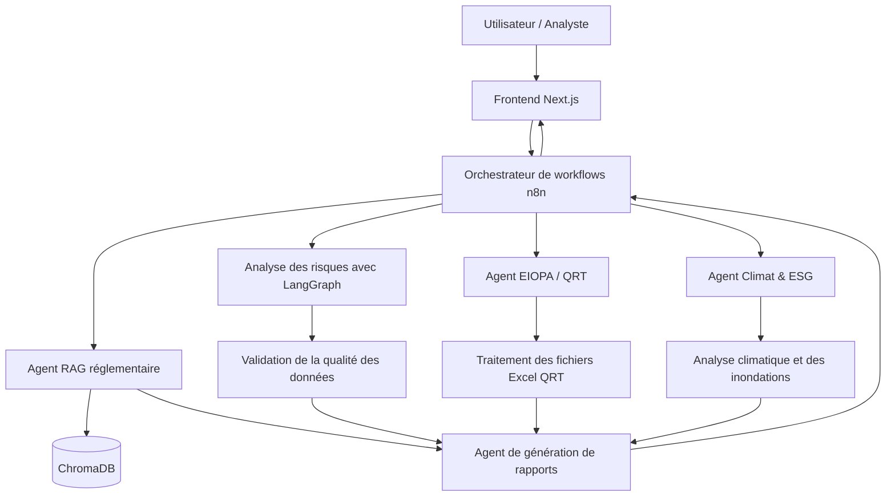

# 🛡️ SolvaRisk
### Plateforme intelligente d'analyse des risques et d'intelligence réglementaire Solvabilité II

  <strong>Rendre l'analyse des risques en assurance plus intelligente, explicable et accessible.</strong>

  
  
  
  
  
  
  

---

## 📌 Présentation du projet

**SolvaRisk** est une plateforme basée sur l'intelligence artificielle, conçue pour accompagner les compagnies d'assurance et les analystes des risques dans la compréhension et la gestion des exigences de **Solvabilité II**, le cadre réglementaire européen applicable aux entreprises d'assurance et de réassurance.

La plateforme combine l'intelligence réglementaire, le traitement des données financières, l'analyse des risques par des agents IA et les tests de résistance climatique au sein d'une application unifiée.

SolvaRisk permet notamment de :

- Explorer la documentation réglementaire Solvabilité II.
- Importer, traiter et analyser les QRT (Quantitative Reporting Templates) de l'EIOPA.
- Comprendre les exigences de capital, notamment le SCR et le MCR.
- Évaluer les fonds propres éligibles et les limites réglementaires.
- Examiner les risques liés à l'assurance grâce à des agents IA spécialisés.
- Évaluer les risques climatiques et l'exposition aux inondations.
- Générer des rapports structurés accompagnés d'explications et de recommandations.

L'application est conçue comme un **outil d'aide à la décision**, visant à améliorer l'accessibilité, la cohérence et l'explicabilité des analyses réglementaires et des risques.

## ✨ Fonctionnalités principales

| Fonctionnalité | Description |
|---|---|
| 📚 RAG réglementaire | Recherche intelligente et réponse aux questions portant sur la documentation Solvabilité II. |
| 📊 Analyse des QRT | Importation, traitement et analyse des fichiers Excel réglementaires de l'EIOPA. |
| 🧮 Analyse du capital | Analyse du SCR, du MCR, des fonds propres éligibles et des modules de risque. |
| 🤖 Intelligence artificielle multi-agents | Collaboration entre des agents spécialisés dans différents domaines d'analyse des risques. |
| 🌍 Tests de résistance climatique | Évaluation de l'exposition climatique et simulation de scénarios liés aux inondations. |
| 🔄 Automatisation des workflows | Coordination des services et des processus d'analyse avec n8n. |
| 📑 Génération de rapports | Production de synthèses structurées, de constats et de recommandations. |
| 💻 Interface interactive | Accès aux fonctionnalités d'intelligence réglementaire et d'analyse des risques via une application web. |

---

## 🏗️ Architecture du système

SolvaRisk repose sur une architecture modulaire combinant une interface Next.js, des services backend développés en Python, des agents IA spécialisés et un système d'orchestration des workflows.

### Composants de l'architecture

- **Frontend :** Next.js, React, TypeScript et Tailwind CSS.
- **Backend :** Python et FastAPI.
- **Moteur RAG :** Recherche et récupération de documents réglementaires.
- **Agents IA :** Agents spécialisés dans l'analyse réglementaire, financière, des risques et climatique.
- **Orchestration multi-agents :** LangGraph et LangChain.
- **Automatisation des workflows :** n8n.
- **Déploiement :** Docker.

### Vue d'ensemble de l'architecture

---

## 🤖 Agents d'intelligence artificielle

SolvaRisk intègre plusieurs composants intelligents spécialisés, chacun étant responsable d'un domaine précis de l'analyse réglementaire ou de l'évaluation des risques.

### 1. 📚 Agent RAG — Intelligence réglementaire

L'agent RAG (Retrieval-Augmented Generation ou génération augmentée par récupération) permet d'interroger intelligemment les réglementations Solvabilité II et la documentation interne.

**Fonctionnalités :**
- Rechercher dans les collections de documents réglementaires.
- Combiner la recherche sémantique et la recherche par mots-clés.
- Extraire et traiter des documents PDF.
- Découper les documents en segments pertinents (chunking).
- Classer et hiérarchiser les résultats de recherche.
- Récupérer les passages réglementaires pertinents.
- Générer des réponses contextualisées accompagnées de références documentaires.

**Technologies utilisées :**
- Python et FastAPI
- API Google Gemini
- ChromaDB
- Sentence Transformers
- Recherche par mots-clés BM25
- Réordonnancement par Cross-Encoder
- PyMuPDF

### 2. 🔍 Pipeline d'analyse des risques avec LangGraph

Le pipeline d'analyse des risques coordonne plusieurs étapes analytiques afin de produire des constats structurés et explicables.

**Fonctionnalités :**
- Vérification de la qualité des données en entrée.
- Investigation des risques identifiés.
- Génération de constats analytiques structurés.
- Classification des risques selon leur niveau de gravité.
- Proposition d'actions correctives et de recommandations.

Le pipeline distingue la validation des données de leur interprétation afin d'améliorer la cohérence et la fiabilité des résultats.

**Technologies utilisées :**
- LangGraph
- LangChain
- API Google Gemini
- Sorties structurées avec Pydantic
- Python
- FastAPI

### 3. 📊 Agent EIOPA & QRT

L'agent EIOPA est spécialisé dans le reporting réglementaire et l'analyse des données quantitatives.

**Fonctionnalités :**
- Lecture et traitement des fichiers Excel QRT.
- Extraction des valeurs réglementaires et des modules de risque.
- Recherche dans les réglementations et la documentation de l'EIOPA.
- Analyse des informations relatives au SCR et au MCR.
- Vérification des classifications Tier et des limites applicables aux fonds propres éligibles.
- Génération ou préparation de livrables liés aux QRT.
- Explication des résultats et des calculs réglementaires.

**Technologies utilisées :**
- Python et FastAPI
- Pydantic
- Traitement des fichiers Excel
- API Google Gemini
- Recherche RAG
- Documentation réglementaire EIOPA
- Structures de données QRT

### 4. 🌍 Agent Climat & ESG

L'agent Climat & ESG évalue l'exposition aux risques environnementaux et climatiques au sein des portefeuilles d'assurance.

**Fonctionnalités :**
- Traitement des données immobilières des portefeuilles d'assurance.
- Analyse des informations géographiques, notamment les villes et les coordonnées.
- Récupération de données météorologiques et climatiques.
- Estimation de l'exposition aux inondations.
- Application de scénarios de stress climatique.
- Production d'indicateurs structurés de risques climatiques.

**Technologies utilisées :**
- Python
- FastAPI
- API Google Gemini
- API météorologiques et climatiques
- Traitement des données de portefeuille
- Calculs de stress liés aux inondations
- Données JSON structurées

### 5. 📑 Agent de génération de rapports

L'agent de génération de rapports centralise les résultats analytiques afin de produire des rapports structurés et faciles à comprendre.

Il combine les informations provenant des différents composants, notamment :

- Les résultats du SCR et du MCR.
- Les conclusions des analyses de risques.
- Les résultats des tests de résistance climatique.
- Les explications réglementaires.
- Les alertes et les risques potentiels identifiés.
- Les recommandations et les actions correctives.

Son objectif est de transformer des résultats analytiques complexes en informations compréhensibles facilitant la prise de décision.

---

## 🔄 Orchestration des workflows avec n8n

**n8n** constitue la couche d'orchestration des workflows. Il coordonne les échanges entre le frontend, les services Python et les différents agents IA spécialisés.

Le workflow peut notamment :

1. Recevoir les requêtes provenant de l'application web.
2. Faire appel à l'agent RAG réglementaire.
3. Déclencher le pipeline d'analyse des risques.
4. Exécuter l'analyse EIOPA et le traitement des QRT.
5. Lancer les tests de résistance climatique.
6. Consolider les résultats des différentes analyses.
7. Générer les rapports.
8. Retourner les résultats vers le frontend.

Cette approche permet de disposer d'une orchestration visuelle et modulaire tout en conservant la logique analytique principale dans des services Python dédiés.

---

## 💻 Application Frontend

Le frontend de SolvaRisk fournit un environnement interactif destiné aux analystes et aux utilisateurs de la plateforme.

**Principales interfaces :**
- Interface de questions-réponses réglementaires.
- Importation et analyse des fichiers QRT.
- Visualisation des informations relatives au SCR et au MCR.
- Interfaces de tests de résistance climatique.
- Consultation des résultats d'analyse des risques.
- Affichage des rapports et des explications générés.

**Technologies utilisées :**
- Next.js
- React
- TypeScript
- Tailwind CSS
- React Markdown
- KaTeX
- XLSX

---

## ⚙️ Backend & Infrastructure RAG

Le backend expose des points d'accès API utilisés par le frontend et les workflows n8n.

**Responsabilités principales :**
- Gérer les requêtes des utilisateurs.
- Charger et traiter les documents réglementaires.
- Extraire le texte des fichiers PDF.
- Découper et indexer les documents.
- Effectuer des recherches sémantiques et par mots-clés.
- Intégrer les modèles Google Gemini.
- Exécuter les agents IA spécialisés.
- Retourner des résultats analytiques structurés.

**Technologies utilisées :**
- Python
- FastAPI
- Uvicorn
- Pydantic
- Google Gemini API
- ChromaDB
- Sentence Transformers
- BM25
- PyMuPDF
- LangGraph

---

## 🐳 Docker & Déploiement

Docker permet de créer des environnements reproductibles pour les services backend et facilite leur déploiement.

Il offre notamment :

- L'isolation des dépendances.
- Des environnements d'exécution cohérents.
- La simplification du déploiement des services.
- Une intégration facilitée avec n8n et les autres composants.
- La réduction des différences entre les environnements de développement.

---

## 🧰 Stack technologique

| Catégorie | Technologies |
|---|---|
| Frontend | Next.js, React, TypeScript, Tailwind CSS |
| Backend | Python, FastAPI, Uvicorn |
| Modèles IA | Google Gemini |
| Framework multi-agents | LangGraph, LangChain |
| Automatisation des workflows | n8n |
| Base de données vectorielle | ChromaDB |
| Embeddings | Sentence Transformers |
| Recherche documentaire | BM25, Cross-Encoder Reranking |
| Traitement documentaire | PyMuPDF |
| Traitement des données | Excel / XLSX, Pydantic |
| Visualisation et rendu | React Markdown, KaTeX |
| Conteneurisation | Docker |
| Gestion de versions | Git, GitHub |

---

## 🎯 Objectifs du projet

SolvaRisk vise à :

- Simplifier l'accès aux informations réglementaires Solvabilité II.
- Améliorer l'interprétation des données réglementaires des compagnies d'assurance.
- Automatiser les tâches répétitives de traitement et d'analyse des données.
- Fournir des investigations spécialisées des risques grâce à l'intelligence artificielle.
- Intégrer l'évaluation des risques climatiques dans l'analyse des portefeuilles d'assurance.
- Améliorer l'explicabilité et l'accessibilité des résultats analytiques.
- Accompagner les analystes dans une prise de décision plus éclairée.

---

---

  <strong>SolvaRisk —  L'intelligence artificielle au service d'une gestion plus intelligente des risques en assurance.</strong>

